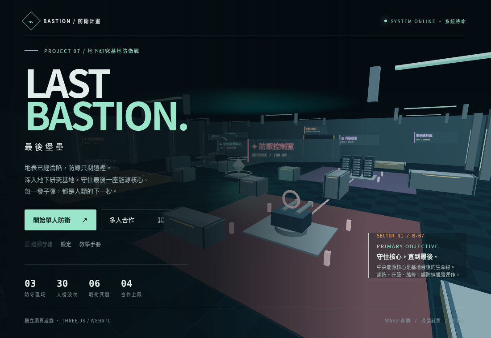
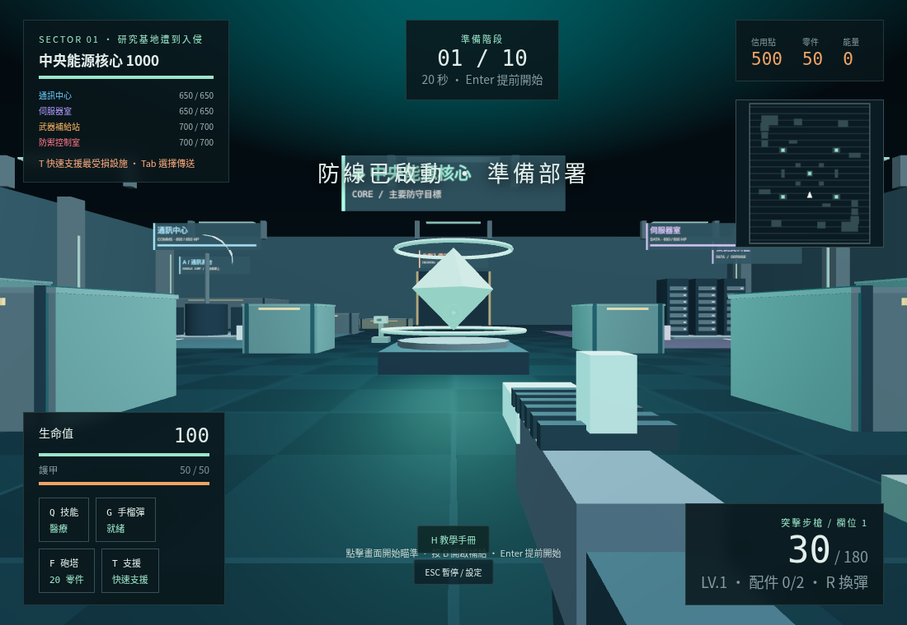
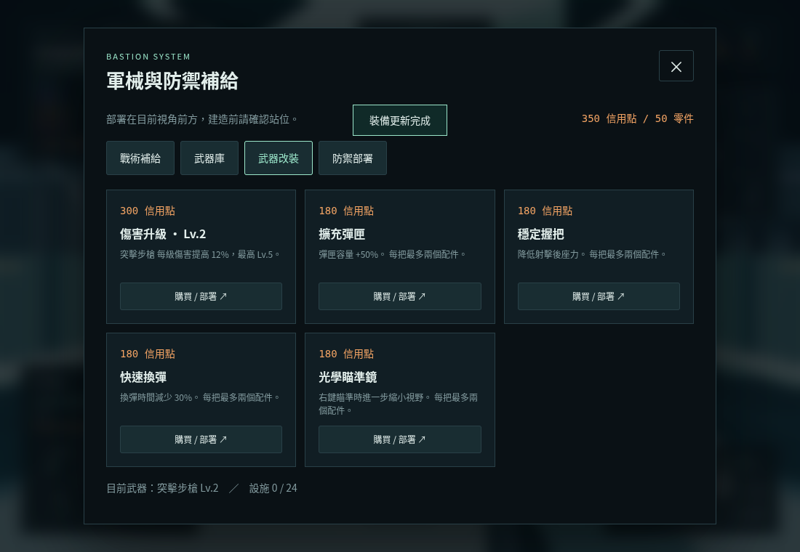
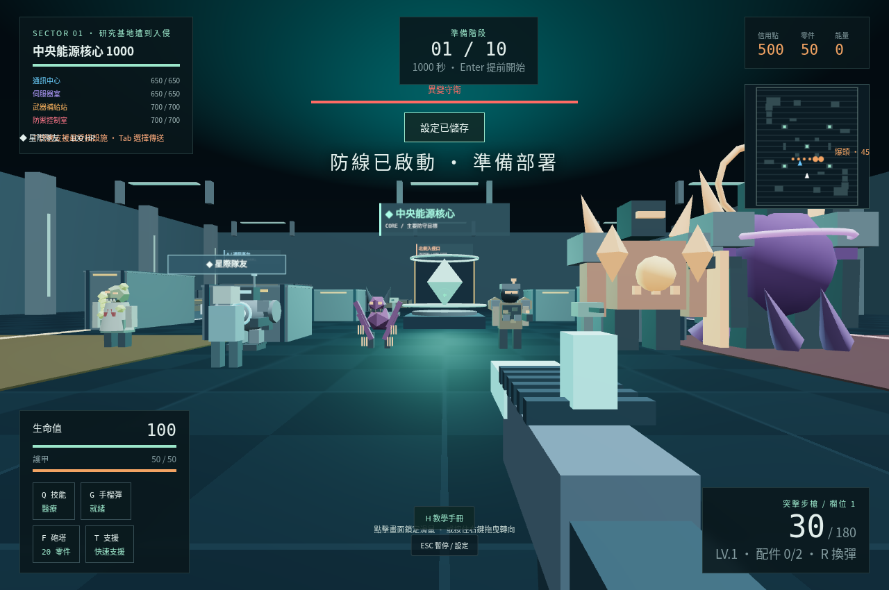
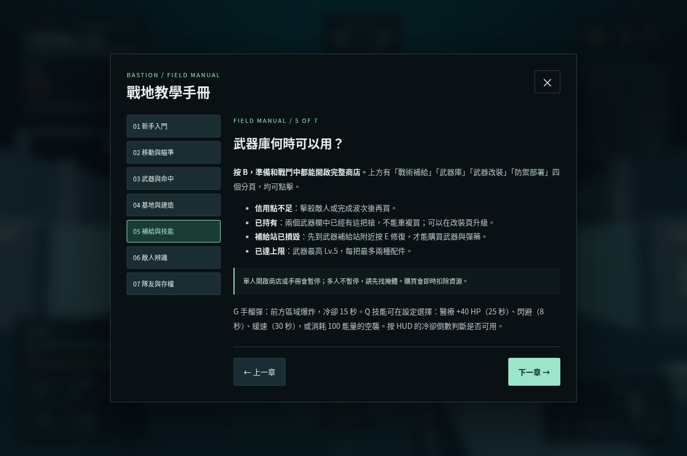
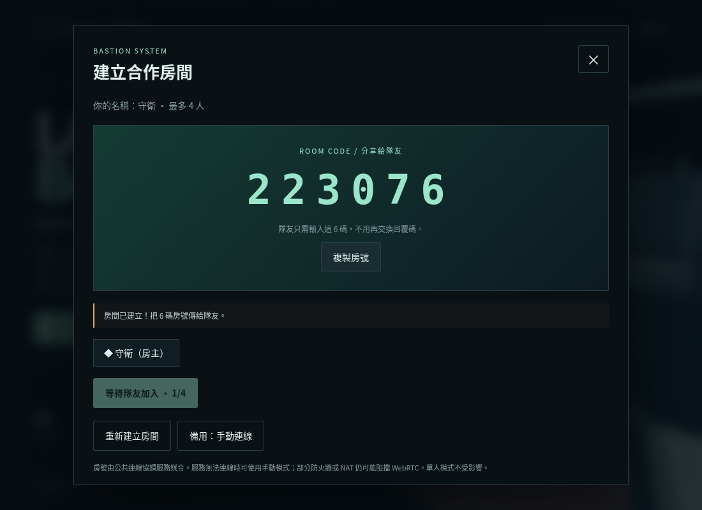
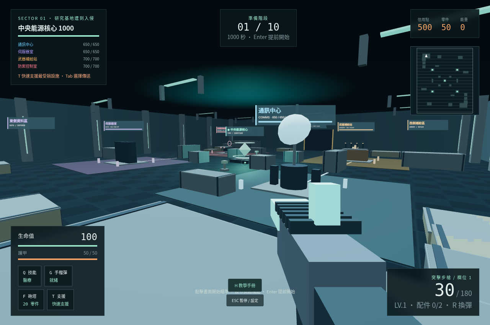
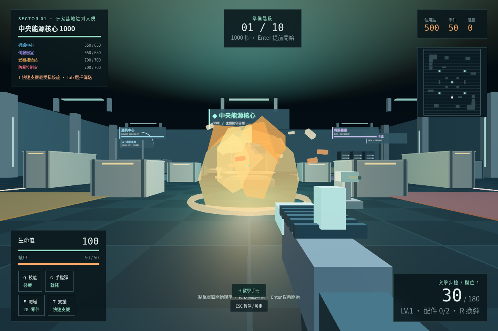
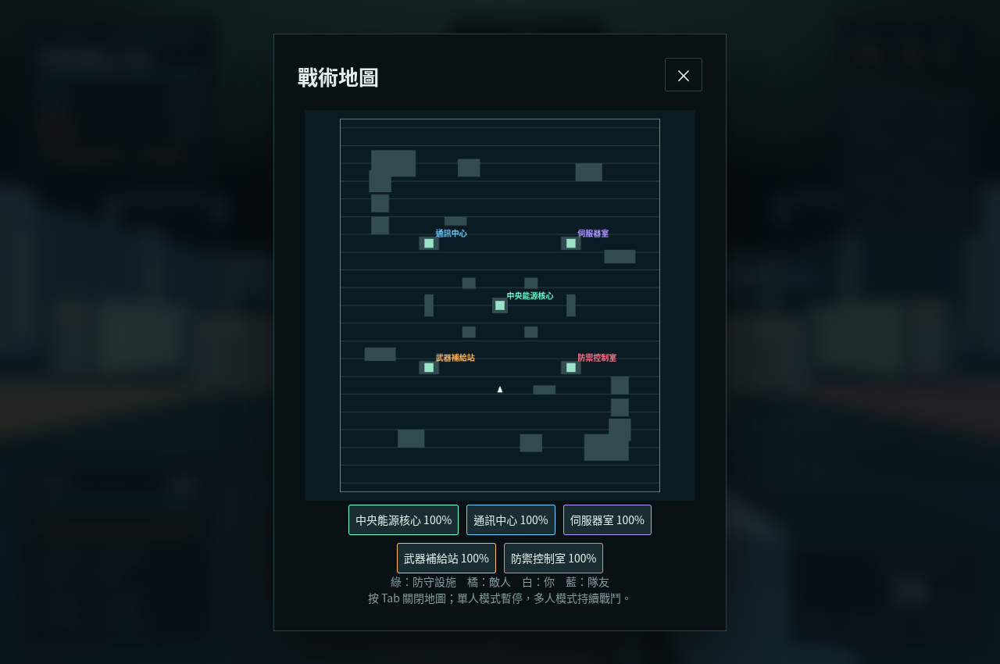

# LAST BASTION · 最後堡壘

地下研究基地 3D 第一人稱防守遊戲。使用 HTML、CSS、JavaScript 與 Three.js，應用程式完整放在單一 **`index.html`**，無需建置。Three.js r128 已內嵌，保留 MIT 授權，單人模式不需 CDN 或多人服務即可執行。

## 開啟方式

可用一般電腦瀏覽器開啟 `index.html`；本雲端受管瀏覽器禁止 `file://`，已驗證的啟動方式是在專案目錄執行：

```sh
python3 -m http.server 8000
```

需要支援 WebGL 的新版 Chrome、Edge 或 Firefox。建議使用鍵盤及滑鼠；手機僅可瀏覽選單，未提供觸控遊戲控制。若不能鎖定滑鼠，可按住右鍵拖曳控制視角；方向鍵與 WASD 一樣用來移動。

## 遊玩

新版基地 **72 × 84 公尺**，新增分色支援區、外圍補給區與兩座階梯高台。Space 在準備和戰鬥都能跳；貨箱可落腳，走出邊緣會掉落。六把武器各有獨立模型，敵人加入感染結晶、能量機械胸腔、裂爪尾刺與 Boss 異變結構。

五座設施分別是能源反應爐、碟形天線、資料機櫃、軍械工作台與雙管控制砲座，具有色標與動態名稱／血條。基地預設兩座守衛砲塔；支援設施血量提高，每波自動修復 8%，提供單人防守緩衝。

已修正上下視角、蹲下時射擊對齊與設施尋路卡住問題，增加可見曳光彈、命中閃光、傷害數字、火花與命中音效。遠距離敵人會追擊可見玩家；槍械可覆蓋基地，遮擋依照 3D 高度判斷。六種敵人各有獨立輪廓與裝備。

- WASD 或方向鍵移動，滑鼠控制視角，左鍵射擊，右鍵瞄準。
- R 換彈，1 / 2 切換兩把武器，Shift 奔跑，Ctrl 蹲下；奔跑中按 Ctrl 滑鏟，Space 二段跳。
- 準備階段按 Enter 提前開戰；B 開啟補給、武器、改裝與建造選單，戰鬥中也能瀏覽和購買。信用點不足、已持有或補給站損毀時會顯示具體原因。
- F 在前方部署砲塔，E 在 8 公尺內修復設施（10 零件恢復 300 HP），G 手榴彈，Q 使用設定中選取的技能。
- T 快速支援最受損設施；Tab 地圖可點選指定設施傳送。冷卻 12 秒，不耗資源。
- H 開啟七章教學手冊；亦可從主選單、HUD 按鈕或暫停選單進入。Tab 戰術地圖，Esc 暫停選單。單人商店、地圖、設定會暫停；多人持續戰鬥。
- 每十波一隻 Boss，三區共 30 波；核心被摧毀即失敗。每波結算自動存檔；戰鬥中手動儲存會回存本波開始前的檢查點。

## 真正多人合作

先在設定輸入玩家名稱（最多 16 字）；合作時會在隊友頭頂及 HUD 顯示名稱。名稱訊息處理與畫面已透過測試資料驗證，實際跨裝置連線仍未通過下述環境限制。

1. 房主選「多人合作 → 建立房間」，等候顯示 **6 碼房號**，按「複製房號」傳給隊友。
2. 隊員選「輸入房號」，輸入六碼數字，按「加入房間」。不需交換回覆碼。
3. 房主看到隊員名稱後按「全隊出發」。一個房號可供最多三位隊員加入；房主需保持頁面開啟。
4. 房號服務無法使用時，選「備用：手動連線」，才需要交換長邀請碼及回覆碼。

六碼房號透過內嵌 **PeerJS 1.5.5 / PeerServer Cloud**（`0.peerjs.com`，HTTPS / WSS）協調；遊戲資料使用 WebRTC 點對點通道，房主仍統一計算狀態。服務不需使用者建立帳號或提供金鑰；單人模式不會連接此服務。房間關閉或重建後，舊房號不能繼續使用。

公共服務可能暫時無法連線。Cloudflare STUN 協助尋找路徑，本版未配置 TURN，某些 NAT / 防火牆仍無法直連。手動模式只能替代協調服務，不能繞過 WebRTC 的網路限制。

六碼房號的介面、驗證與通訊適配已使用可重現的測試資料通過驗收。**本雲端代理拒絕公共房號服務，且受管瀏覽器禁止 WebRTC UDP，實際跨裝置多人尚未驗證成功。** 詳見測試紀錄；不將測試資料冒充真實連線。房主存檔可日後以單人模式載入；未實作重連接管與房主遷移。

## GitHub Pages 發布

程式已成功推送至 `main`；Pages 設定與公開存取尚未驗證，詳見 [發布紀錄](docs/發布紀錄.md)。

目標網址：`https://eric78100313.github.io/game1/`（須先完成 Pages 設定及部署，請勿在驗證前當成已公開網址）。

程式碼在 GitHub 的 `main` 後，前往儲存庫 **Settings → Pages → Build and deployment**：

1. Source 選 **Deploy from a branch**。
2. Branch 選 **main**，資料夾選 **/ (root)**，按 **Save**。
3. 等待 Pages 部署完成，在未登入的視窗開啟網址，測試開始遊戲與射擊。
4. 若儲存庫是私人，須確認帳號方案支援私人儲存庫的 Pages，或依自己的需求調整可見性。

不需要額外建置、不需要 API 金鑰。`.nojekyll` 告知 Pages 直接提供靜態檔案。

## 規格、截圖與驗證

- [原始規格書](docs/原始遊戲規格書.md)：保留使用者提出的完整目標。
- [實作規格與差異](docs/實作規格書.md)：本版實際玩法與未完成項目。
- [測試紀錄](docs/測試紀錄.md)：瀏覽器驗證方式、結果及界線。
- [繳交文字範本](docs/繳交內容.md)：填入個人資訊與確認公開網址後使用。











## 重跑測試

使用 Node.js、Playwright 與 `/usr/bin/chromium`，先啟動上面的 HTTP server，再於專案目錄執行：

```sh
node tests/acceptance.cjs
node tests/multiplayer.cjs
node tests/offline.cjs
node tests/controls-combat.cjs
node tests/arsenal-team-distance.cjs
node tests/expanded-base.cjs
node tests/simple-rooms.cjs
node tests/simple-rooms-live.cjs
```

若尚未安裝 Playwright，可於儲存庫外安裝：`npm install --prefix /tmp/bastion-test-tools playwright`，並設定 `NODE_PATH=/tmp/bastion-test-tools/node_modules`。測試會更新 `docs` 中的截圖及結果 JSON。單人測試透過測試頁面注入內部函式介面，驗證實際程式邏輯；正式 HTML 僅有唯讀診斷資料，不含跳關或作弊控制。多人測試使用兩個獨立 Chromium 程序嘗試真正 WebRTC，並非模擬訊息；目前雲端政策導致無 ICE 路徑，回傳退出碼 2（blocked），不視為通過。
